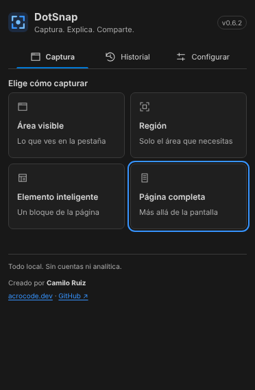

# DotSnap

**Captura. Explica. Comparte.** Extensión de Chrome para capturar una página, anotarla y exportarla con control sobre el formato y el peso. Todo ocurre en tu dispositivo: sin cuentas, sin analítica, sin servicios remotos.

[English](README.md) · [Cambios](CHANGELOG.md) · [Documentación](docs/)



## Qué hace

- **Cuatro formas de capturar:** área visible, región (arrastra un rectángulo y ajústalo), elemento inteligente (pasa el cursor y elige un bloque de la página) y página completa (se desplaza y une los tramos).
- **Editor:** flechas, líneas, rectángulos, elipses, resaltador, pasos numerados, texto (nueve fuentes del sistema) y censura (sólida, pixelada o desenfocada). Seleccionar, mover, redimensionar, borrar, deshacer y rehacer.
- **Exportación:** PNG, JPEG, WebP y PDF; escala; calidad de JPEG/WebP; un **peso objetivo** que busca la mayor calidad que cabe; PDF en páginas A4, Carta o del tamaño de la imagen, que reparte las capturas largas en varias páginas sin cortar filas. El peso que se muestra es el del archivo real, junto al del PNG original.
- **Copiar al portapapeles** como PNG y descarga con un nombre de archivo que puedes personalizar.
- **Historial:** capturas recientes con miniatura; reábrelas con sus anotaciones, elimina una o todas. Se conservan 1, 7 o 30 días (tú eliges), nunca en incógnito, y se puede desactivar.
- **Proyecto editable** (`.dotsnap.json`): guarda y reabre tu trabajo. Contiene la imagen original, así que no lo compartas como si fuera la exportación.
- **Atajos de teclado:** Alt+Shift+V (visible), R (región), E (elemento), F (página completa).
- Español e inglés, con tema Sistema/Claro/Oscuro.

## Privacidad y permisos

| Permiso     | Para qué                                                                                     |
| ----------- | -------------------------------------------------------------------------------------------- |
| `activeTab` | Capturar la pestaña en la que estás, solo después de pulsar el icono                         |
| `scripting` | Inyectar el ayudante de región, elemento o página completa en esa pestaña, solo tras tu clic |
| `storage`   | Preferencias de idioma/tema y capturas temporales (24 h, en este dispositivo)                |

Sin permisos de hosts, sin content scripts permanentes, sin `downloads`, sin debugger y sin red. La censura se aplana en la imagen exportada: la **sólida** no deja ninguno de los píxeles ocultos; pixelado y desenfoque son menos seguros, así que usa la sólida para datos sensibles.

## Instalación

1. Compílala (ver abajo) o toma el ZIP y descomprímelo.
2. Abre `chrome://extensions`, activa el **Modo de desarrollador** y pulsa **Cargar descomprimida**.
3. Selecciona la carpeta `.output/chrome-mv3`.
4. Después de recompilar, pulsa **Recargar** en la tarjeta de la extensión.

## Uso

Abre una página, pulsa el icono de DotSnap y elige un modo. El editor se abre en una pestaña nueva: anota y luego usa **Descargar PNG** para guardar rápido o **Exportar…** para otros formatos, escala y peso. **Descartar** cierra la pestaña. En la página completa el icono muestra el avance (`3/8`), Escape cancela y un fallo se indica con `!`; abre el popup para leer la causa y su detalle técnico.

## Límites

- La página completa solo desplaza el documento: las páginas cuyo contenido se mueve dentro de un panel se capturan como el área visible.
- Los elementos fixed y sticky aparecen una vez, en el primer tramo. El contenido que cambia durante la captura (carruseles, vídeo, scroll infinito) se captura como está cuando pasa cada tramo.
- Hasta 120 tramos y 12 partes por captura; por encima se rechaza antes de capturar. Cada parte respeta 8192 px por lado.
- No se pueden capturar páginas `chrome://`, la Chrome Web Store ni otras páginas restringidas.
- Edge y versiones anteriores de Chrome no se han probado.

## Compilación

Requiere Node 22.12+ y npm. El lockfile fija las dependencias: usa `npm ci`.

```powershell
cd C:\Proyectos\dotsnap
npm ci
npm run build
npm run zip
```

| Script                 | Qué hace                                                                                                                 |
| ---------------------- | ------------------------------------------------------------------------------------------------------------------------ |
| `npm run dev`          | WXT con recarga de desarrollo                                                                                            |
| `npm run build`        | Iconos locales + extensión de producción en `.output/chrome-mv3`                                                         |
| `npm run zip`          | Iconos y ZIP instalable en `.output/`                                                                                    |
| `npm run lint`         | ESLint y verificación de Prettier                                                                                        |
| `npm run typecheck`    | Tipos de WXT + TypeScript estricto                                                                                       |
| `npm run test`         | Pruebas unitarias con Vitest (geometría, unión, exportación, PDF, preferencias)                                          |
| `npm run test:m1`…`m5` | Pruebas de extremo a extremo en Chromium con variante de pruebas: captura, región/elemento, página completa, exportación |
| `npm run test:browser` | Chrome instalado, perfil aislado, 8 vistas, axe, teclado, persistencia, errores de consola                               |

Los scripts de extremo a extremo necesitan `DOTSNAP_CHROME` apuntando a un Chromium. Las notas de validación y los límites conocidos por hito están en `docs/validacion-m*.md`.

## Organización

- `src/entrypoints/`: worker, popup, editor, opciones y los ayudantes bajo demanda (región/elemento y página completa).
- `src/shared/`: captura, geometría, exportación (formatos, PDF, codificación), i18n, tema y almacenamiento.
- `src/editor/`: el lienzo Konva con su modelo e historial.
- `docs/`: arquitectura, riesgos de API, matriz de funciones, plan y validación.

## Licencia

Aún sin decidir; el proyecto es privado hasta elegir la licencia de distribución.
