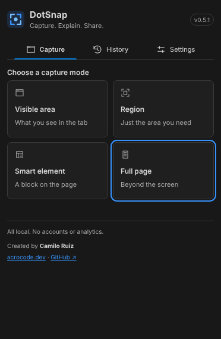

# DotSnap

**Capture. Explain. Share.** A Chrome extension to capture a page, annotate it and export it with control over format and size. Everything happens on your device: no accounts, no analytics, no remote services.

[Español](README.es.md) · [Changelog](CHANGELOG.md) · [Docs](docs/)



## What it does

- **Four ways to capture:** visible area, region (drag a rectangle and adjust it), smart element (hover and pick a block of the page) and full page (scrolls and stitches).
- **Editor:** arrows, rectangles, text (nine system fonts), and redaction (solid, pixelate or blur). Select, move, resize, delete, undo and redo.
- **Export:** PNG, JPEG, WebP and PDF; scale; JPEG/WebP quality; a **target size** that finds the highest quality that fits; a PDF with A4, Letter or image-size pages that splits long captures across pages without cutting rows. The size shown is that of the real file, next to the original PNG.
- **Copy to the clipboard** as PNG, and download with a file name you can template.
- **History:** recent captures with thumbnails; reopen them with their annotations, delete one or all. Kept 1, 7 or 30 days (your choice), never in incognito, and it can be turned off.
- **Editable project** (`.dotsnap.json`): save and reopen your work. It contains the original image, so don't share it as if it were the export.
- **Keyboard shortcuts:** Alt+Shift+V (visible), R (region), E (element), F (full page).
- Spanish and English, with System/Light/Dark theme.

## Privacy and permissions

| Permission  | Why                                                                               |
| ----------- | --------------------------------------------------------------------------------- |
| `activeTab` | Capture the tab you are on, only after you click the icon                         |
| `scripting` | Inject the region, element or full-page helper in that tab, only after your click |
| `storage`   | Language/theme preferences, and temporary captures (kept 24 h, on this device)    |

No host permissions, no permanent content scripts, no `downloads`, no debugger, no network. Redaction is flattened into the exported image: **solid** leaves none of the hidden pixels; pixelate and blur are less safe, so use solid for sensitive data.

## Install

1. Build it (see below) or take the ZIP and unzip it.
2. Open `chrome://extensions`, turn on **Developer mode** and click **Load unpacked**.
3. Select the `.output/chrome-mv3` folder.
4. After rebuilding, click **Reload** on the extension card.

## Use

Open a page, click the DotSnap icon and pick a mode. The editor opens in a new tab: annotate, then **Download PNG** for a quick save or **Export…** for other formats, scale and size. **Discard** closes the tab. In full-page capture the icon shows progress (`3/8`), Escape cancels, and a failure shows `!`; open the popup to read the cause and its technical detail.

## Limits

- Full page scrolls the document only: pages whose content scrolls inside a panel are captured as the visible area.
- Fixed and sticky elements appear once, in the first segment. Content that changes while capturing (carousels, video, infinite scroll) is captured as it is when each segment passes.
- Up to 120 segments and 12 parts per capture; above that it is refused before capturing. Each part stays within 8192 px per side.
- Chrome pages (`chrome://`), the Chrome Web Store and other restricted pages cannot be captured.
- Edge and older Chrome versions have not been tested.

## Build

Requires Node 22.12+ and npm. The lockfile pins dependencies: use `npm ci`.

```powershell
cd C:\Proyectos\dotsnap
npm ci
npm run build
npm run zip
```

| Script                 | What it does                                                                                |
| ---------------------- | ------------------------------------------------------------------------------------------- |
| `npm run dev`          | WXT with development reload                                                                 |
| `npm run build`        | Local icons + production extension in `.output/chrome-mv3`                                  |
| `npm run zip`          | Icons and the installable ZIP in `.output/`                                                 |
| `npm run lint`         | ESLint and Prettier check                                                                   |
| `npm run typecheck`    | WXT types + strict TypeScript                                                               |
| `npm run test`         | Vitest unit tests (geometry, stitching, export, PDF, preferences)                           |
| `npm run test:m1`…`m5` | End-to-end checks in Chromium with a test build: capture, region/element, full page, export |
| `npm run test:browser` | Installed Chrome, isolated profile, 8 views, axe, keyboard, persistence, console errors     |

End-to-end scripts need `DOTSNAP_CHROME` pointing to a Chromium. Validation notes and known limits per milestone are in `docs/validacion-m*.md`.

## Project layout

- `src/entrypoints/`: worker, popup, editor, options, and the on-demand helpers (region/element and full page).
- `src/shared/`: capture, geometry, export (formats, PDF, encoding), i18n, theme and storage.
- `src/editor/`: the Konva canvas and its model/history.
- `docs/`: architecture, API risks, feature matrix, plan and validation.

## License

Not decided yet; the project is private until the distribution license is chosen.
